<div align="center">


# Checkpoint

**Mạng xã hội du lịch cho Việt Nam: check-in, cắm cờ lên bản đồ và sưu tầm con dấu trên hộ chiếu du lịch số của bạn.**

Check-in địa điểm · Pin lên map gamified · Upload khoảnh khắc · Kiếm XP · Build **digital travel passport**

<br/>


<br/>


<br/>
[](https://checkpoint-app.space)

<br/>


</div>

---

## 🎬 Demo

<div align="center">

<a href="docs/demo/checkpoint-demo.mp4"></a>

<sub>Bản đồ → Xem check-in → Đang hot gần bạn → Chi tiết địa điểm → Hồ sơ du lịch → Khoảnh khắc<br/>
▶ Bấm vào ảnh để xem <a href="docs/demo/checkpoint-demo.mp4">video đầy đủ</a> · Dùng thử tại <a href="https://checkpoint-app.space">checkpoint-app.space</a></sub>

</div>

---

## 🎯 Bài toán & giải pháp

| Bài toán của người đi du lịch | Checkpoint giải quyết thế nào |
|---|---|
| Kỷ niệm chuyến đi nằm rải rác trong thư viện ảnh và các bài đăng, không có một bản đồ “mình đã đi những đâu”. | Mỗi check-in là một lá cờ GPS trên bản đồ cá nhân; các lá cờ gom thành **hành trình** có timeline, đường đi trên map và quãng đường. |
| Muốn tìm chỗ hay quanh mình phải lướt nhiều nhóm review, thông tin không gắn với vị trí. | **Khám phá** theo khoảng cách thật: “Đang hot gần bạn”, địa điểm gần nhất (PostGIS `ST_DWithin`), tìm kiếm có dấu/không dấu. |
| Đi xong là thôi, không có động lực đi tiếp hay chia sẻ. | **XP, level, huy hiệu, bảng xếp hạng** và **hộ chiếu số** — mỗi tỉnh thành đã đến cho một con dấu; share card 1200×630 hiện preview lớn trên Messenger. |
| Người mới ngại đăng ký ngay từ đầu. | Dùng thử bằng **tài khoản Khách**; nâng cấp lên Email/Google sau vẫn giữ nguyên check-in, hành trình và XP. |
| Một sản phẩm cá nhân, ngân sách gần như bằng 0. | Toàn bộ chạy ở free tier (Cloud Run, Supabase, R2, Pages) — khoảng **$0/tháng** với traffic thấp. |

**Cách dự án được quản lý:** roadmap **7 phase · 16 tính năng** trong [CHECKPOINT.md](CHECKPOINT.md); tiến độ từng tính năng cập nhật sau mỗi lần dev ở [docs/STATUS.md](docs/STATUS.md); mỗi tính năng lớn có một bản kế hoạch riêng trong `docs/` trước khi làm. Hạng mục không đáng giá (AI trip planner) được chốt bỏ có ghi lý do, thay vì để treo.

---

## ✨ Tính năng nổi bật

<table>
<tr>
<td width="50%" valign="top">

🗺️ **Bản đồ check-in.** Dùng MapLibre và PostGIS để tìm địa điểm gần bạn (`ST_DWithin`) và tải marker theo vùng đang xem.

📸 **Khoảnh khắc.** Upload ảnh/video thẳng lên R2. Video được transcode bất đồng bộ qua Pub/Sub và worker ffmpeg.

🧭 **Hành trình.** Xem timeline, polyline trên map, quãng đường và thống kê. Có thể có nhiều journey active cùng lúc.

</td>
<td width="50%" valign="top">

🏅 **Gamification.** Nhận XP sau mỗi check-in, lên level, xếp hạng trên leaderboard và mở khoá huy hiệu.

🛂 **Hộ chiếu du lịch số.** Mỗi tỉnh thành bạn đã đến cho bạn một con dấu.

🔗 **Chia sẻ.** Share card tạo bằng Canvas2D, ảnh OG 1200×630 hiện preview lớn trên Messenger, có deep link `/c/:id` và `/j/:id`.

</td>
</tr>
</table>

---

## 📱 Giao diện

<table>
<tr>
<td align="center">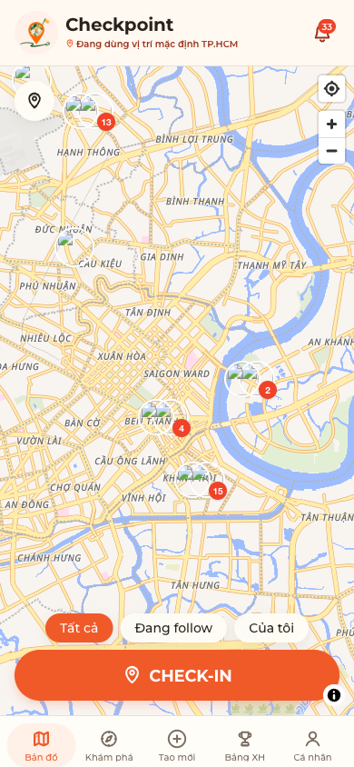<br/><sub><b>Bản đồ</b></sub></td>
<td align="center">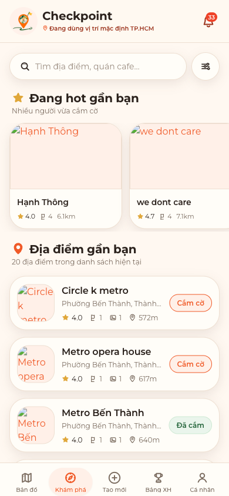<br/><sub><b>Khám phá</b></sub></td>
<td align="center">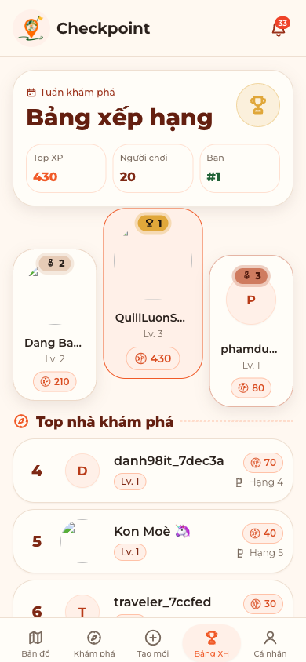<br/><sub><b>Bảng xếp hạng</b></sub></td>
</tr>
<tr>
<td align="center">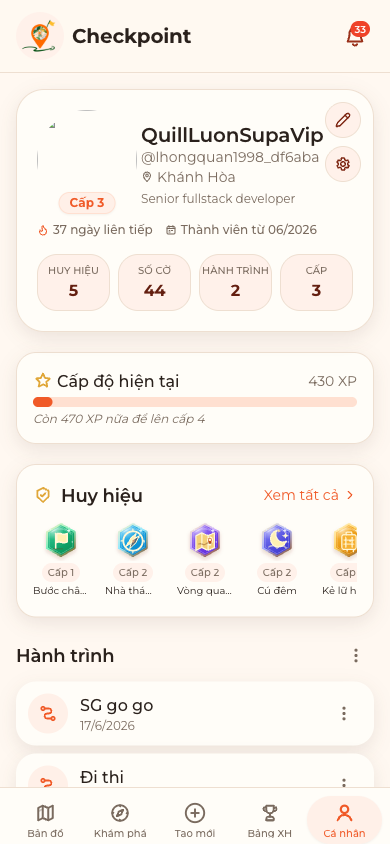<br/><sub><b>Hồ sơ</b></sub></td>
<td align="center">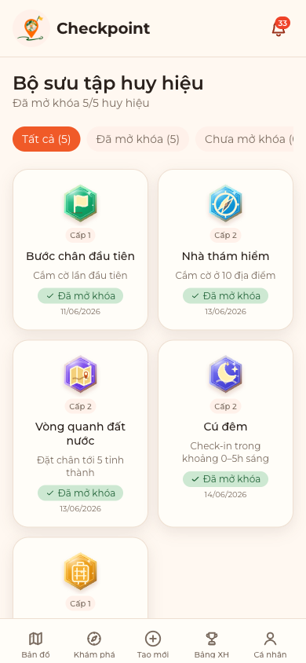<br/><sub><b>Huy hiệu</b></sub></td>
<td align="center">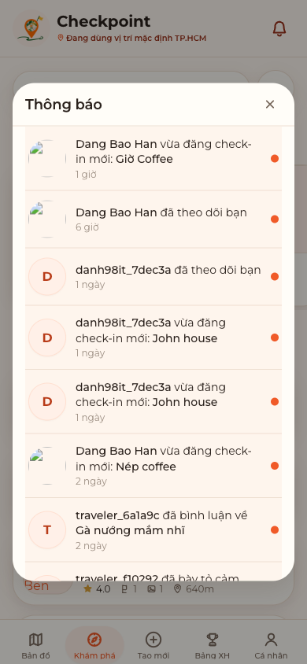<br/><sub><b>Thông báo</b></sub></td>
</tr>
</table>

<details>
<summary><b>Xem thêm ảnh chụp màn hình</b></summary>
<br/>

| Landing | Đăng nhập | Sửa hồ sơ | Desktop |
|:---:|:---:|:---:|:---:|
| 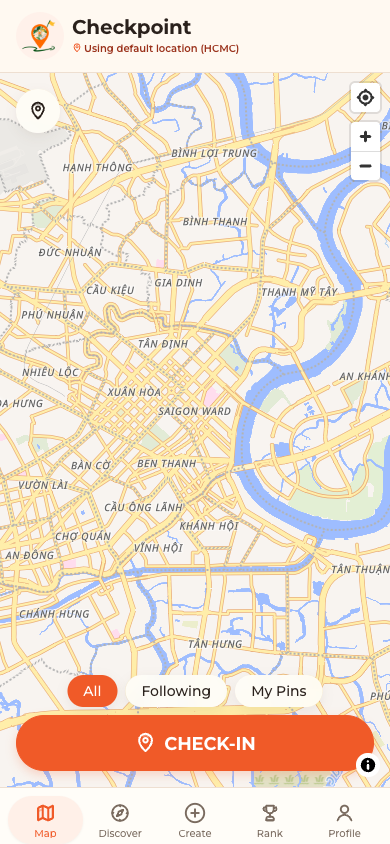 | 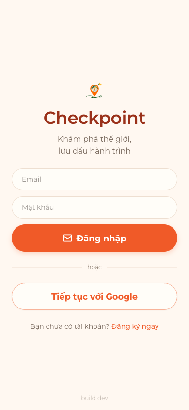 | 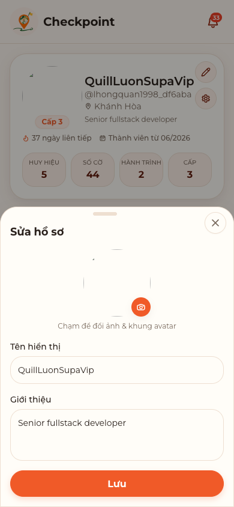 | 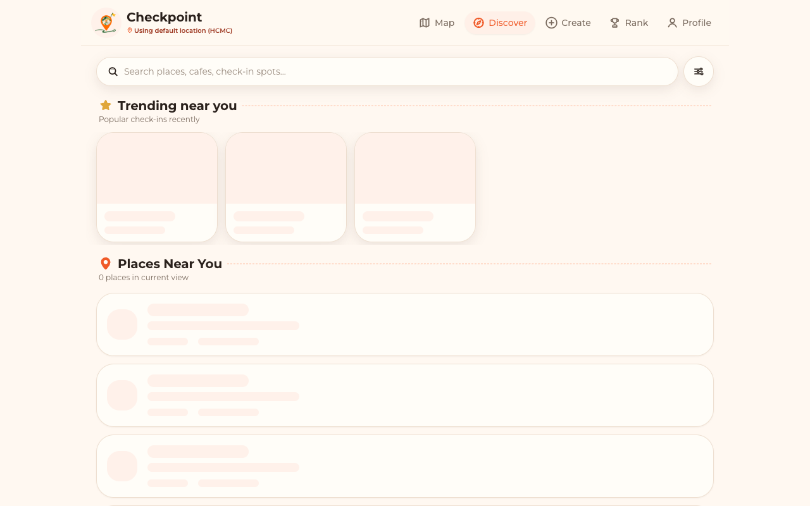 |

</details>

---

## 🚦 Tiến độ

```
Phase 1  Foundation       ██████████████████  100%  Auth · Profile · PWA
Phase 2  Checkpoint Core  ████████████████░░   90%  M1–M7 ✅ · còn M8 polish
Phase 3  Journey          ████████████████░░   90%  J1–J5 ✅
Phase 4  Discovery        ██████████████████  100%  Search · Nearby · Feed · Popular
Phase 5  Gamification     ████████████████░░   90%  XP · Hộ chiếu · Leaderboard · Huy hiệu
Phase 6+ AI / Polish      ░░░░░░░░░░░░░░░░░░    0%  AI trip planner đã chốt bỏ qua
```

| | Tiến độ | Ghi chú |
|---|:---:|---|
| **Backend** | `~95%` | Auth, Profile, Checkpoint, Journey, Discovery, XP, Follow, View count và **Reactions** đều đã chạy thật |
| **Frontend** | `~85%` | Đã nối API và auth end-to-end: map thật, check-in, detail, comments, reactions, **bộ icon SVG tự host** |

👉 Bảng so sánh chi tiết 16 feature ở **[docs/STATUS.md](docs/STATUS.md)**. Roadmap đủ 7 phase ở **[CHECKPOINT.md](CHECKPOINT.md)**.

---

## 🏗️ Kiến trúc

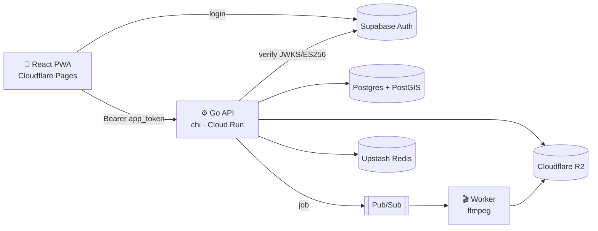

<details>
<summary><b>🔐 Luồng xác thực</b></summary>

```
STEP 1  FE → Supabase login                        → supabase_token
STEP 2  FE → POST /auth/exchange (supabase_token)  → BE verify (JWKS / ES256)
                                                    → lookup/create user
                                                    → app_token (15m) + refresh_token (7d)
STEP 3  FE → API calls (Bearer app_token)          → middleware Go verify
STEP 4  app_token hết hạn → POST /auth/refresh     → rotate → cặp token mới
```

- Supabase auth được tách khỏi business logic, nên backend **toàn quyền kiểm soát** token lúc runtime.
- `refresh_token` chỉ lưu dạng **hash SHA-256**, nên có thể revoke và dù DB bị lộ thì token cũng vô dụng.
- **Rotation:** mỗi lần refresh, token cũ bị thu hồi.

</details>

---

## 🧰 Tech stack

| Layer | Tech |
|---|---|
| **Backend** | Go 1.25 · chi · pgx · JWT (JWKS/ES256) |
| **Frontend** | Vite · React 19 PWA · Tailwind v4 · MapLibre · TanStack Query |
| **Database** | Supabase Postgres + PostGIS · pg_trgm |
| **Storage / Cache** | Cloudflare R2 · Upstash Redis |
| **Infra** | GCP Cloud Run (API + worker) · Pub/Sub · Cloudflare Pages · GitHub Actions |

> Tất cả chạy ở free tier, khoảng **$0/tháng** với traffic thấp.

---

## 📂 Cấu trúc repo

Checkpoint gồm repo tổng này (tài liệu, thiết kế, roadmap) và 4 repo mã nguồn:

| Repo | Nội dung | Trạng thái |
|---|---|---|
| [checkpoint-app-go](https://github.com/handao2303/checkpoint-app-go) | Go API + worker ffmpeg trên Cloud Run | ✅ đang chạy |
| [checkpoint-app-reactjs](https://github.com/handao2303/checkpoint-app-reactjs) | React 19 PWA — bản đang chạy tại [checkpoint-app.space](https://checkpoint-app.space) | ✅ đang chạy |
| [checkpoint-app-rn](https://github.com/handao2303/checkpoint-app-rn) | App React Native (Expo SDK 56) cho iOS / Android | 🔄 parity với web |
| [checkpoint-app-flutter](https://github.com/handao2303/checkpoint-app-flutter) | App Flutter cho iOS / Android, kèm cache ảnh cục bộ | 🔄 giai đoạn đầu |

```
checkpoint/
├── backend/        Go API: chi, pgx/Supabase, JWT, R2, Cloud Run    → checkpoint-app-go
├── web/            Vite + React 19 PWA: Tailwind v4, Cloudflare     → checkpoint-app-reactjs
├── design/         mockups + design tokens (design/tokens/)
├── docs/           STATUS.md · backend.md · frontend.md · các plan
├── demo-video/     mã nguồn HyperFrames của video demo (docs/demo/)
├── checkpoint_*_svg/  bộ icon huy hiệu, level, khung avatar
└── CHECKPOINT.md   roadmap đầy đủ (7 phases, 16 features)
```

---

## 🚀 Bắt đầu nhanh

```bash
# Backend
cd backend && make setup          # .env + migrate CLI + deps
make migrate-up && make run       # :8080 → curl localhost:8080/health

# Frontend
cd web && npm install && npm run dev   # :5173
```

Hướng dẫn deploy nằm ở `backend/DEPLOY.md`.

---

## 📝 Quy ước

Sau **mỗi lần dev**, cần cập nhật [docs/STATUS.md](docs/STATUS.md), cùng với `docs/backend.md` hoặc `docs/frontend.md` (và README nếu đổi scope), để tài liệu luôn khớp với tiến độ thực tế.

<div align="center">
<br/>
<sub>Làm bằng ☕ và rất nhiều check-in khắp Việt Nam 🇻🇳</sub>
</div>
